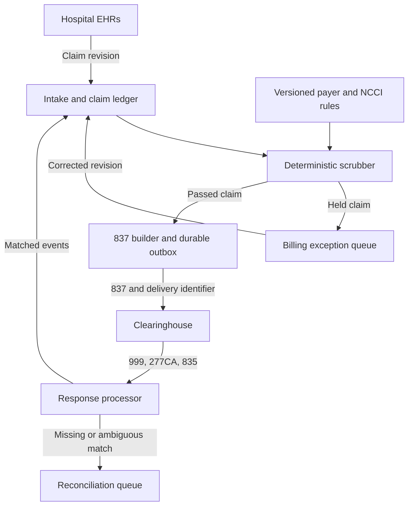

# Claims Platform

## Use case

A hospital claims platform receives **1.5 million claims per month from 40 hospital EHRs**. It validates institutional and professional claims against payer requirements and applicable NCCI edits, sends X12 837s through a clearinghouse, and matches the returning 999, 277CA, and 835 transactions. Hospital billing teams need to know which claims require correction, which reached the payer, and how the payer adjudicated them.

Three cases drive the design. EHRs can replay a batch, payer rules can change while claims are staged, and the clearinghouse can receive a file even when the sender times out. The platform needs to recover from each case without issuing duplicate original submissions or losing the claim history.

## System design



[Open the animated workflow replay](docs/claims-workflow.html) to follow a clean claim, a lost clearinghouse receipt, or a payer-rule rollback. Download the HTML file and open it in a browser to run the animation.

## How the design solves the problem

| Design decision | How it works | Why it matters |
| --- | --- | --- |
| **Durable claim ledger** | Normalize incoming data and store immutable revisions keyed by hospital, source claim ID, and revision. Identical replays return the existing ID. Conflicting payloads under the same key are surfaced for review. | Hospitals can retry intake safely, and operators can trace each decision to the source revision. |
| **Deterministic, versioned edits** | Evaluate payer rules and applicable NCCI edits against the effective date. Persist the rule bundle and route generation with each scrub decision. Rollback reactivates a previous approved bundle and advances the generation. The dispatch gate blocks stale staged claims until they are re-scrubbed. | Billing teams can reproduce a hold, and an operator can roll back a bad release without letting stale claims leave the outbox. |
| **Durable outbox and duplicate prevention** | Persist the outbound payload and delivery ID before sending. Treat a timeout as unknown delivery and query the original delivery ID. The simulator verifies the receipt against the persisted payload hash. A production route needs verified partner deduplication through onward forwarding for safe automatic retries. | A lost receipt can hide a successful submission. Reconciling the original delivery prevents a blind resend. |
| **Separate acknowledgment and adjudication events** | Correlate the **999** at transaction-set level, the **277CA** at claim level, and the **835** using claim and payer references. Store responses idempotently and retain unmatched responses for review. The simulator uses a shared synthetic delivery reference. | A claim can pass front-end intake and later be denied. Separate events preserve that distinction and support duplicates and out-of-order arrivals. |
| **AI-assisted exception triage** | The prototype exposes read-only rule evidence. A future agent can explain holds and route work to a billing team. Humans approve claim changes, rule publication, ambiguous matches, and resubmission decisions. | Staff can investigate faster while billing and submission decisions stay auditable. |

## Production targets

At 1.5 million claims per 30-day month, the average is about **50,000 claims per day**. Hospital batch uploads drive capacity planning. These are proposed pilot targets and require validation with representative workloads and trading partners.

| Measure | Target |
| --- | --- |
| Intake, scrub, and outbound staging | **50 claims/sec sustained**, **150 claims/sec for 15 minutes** |
| Intake availability | **99.95% monthly** |
| Durable intake to scrub decision | **p95 ≤30 seconds**, **p99 ≤2 minutes** |
| Clean claim to clearinghouse receipt | **p95 ≤5 minutes** on healthy routes with sufficient partner capacity |
| Inbound response to match or review queue | **p95 ≤60 seconds** |
| Payer-rule rollback and stale-dispatch fencing | **≤5 minutes** from approval |
| First-pass payer acceptance | **≥98%** on covered routes within **two business days**. Rejections and missing or indeterminate acknowledgments count as misses. |

## Requirements

- Python 3.10 or newer

This implementation has no third-party runtime dependencies.

## Run the tests

```sh
python -m unittest -v
```

The test suite covers:

- Duplicate and conflicting claim intake
- Lost clearinghouse receipts and reconciliation
- Repeated and unmatched response events
- Payer-rule changes and staged-work rollback
- Effective-dated edit rules

## Example

```python
from claims import Ledger, SimulatedClearinghouse

ledger = Ledger("ledger.db")
clearinghouse = SimulatedClearinghouse("gateway.db")

ledger.publish("v1", {})
ledger.activate("demo-payer", "v1")

claim_id = ledger.intake({
    "hospital": "demo-hospital",
    "source": "claim-001",
    "revision": 1,
    "payer": "demo-payer",
    "type": "I",
    "service_date": "2026-11-01",
    "lines": [{"code": "DEMO1", "units": 1, "cents": 12000}],
})

findings, delivery_id = ledger.stage(claim_id)
if not findings:
    ledger.dispatch(delivery_id, clearinghouse)
```

## Repository layout

- `claims.py` — SQLite ledger, scrubber, dispatcher, response processor, and clearinghouse simulator
- `test_claims.py` — scenario-based unit tests
- `docs/design.md` — implementation and production design details
- `docs/claims-workflow.html` — interactive workflow replay

Open `docs/claims-workflow.html` directly in a browser to replay clean, timeout, and rollback scenarios.

## Documentation

- [Design and production targets](docs/design.md)
- [Claims workflow replay](docs/claims-workflow.html)

## Scope

This repository is a reference and simulation. It does not contain a production EHR integration or a complete X12 5010 implementation. Real deployments should replace the synthetic format and response dictionaries with licensed translators and trading-partner companion guides.
